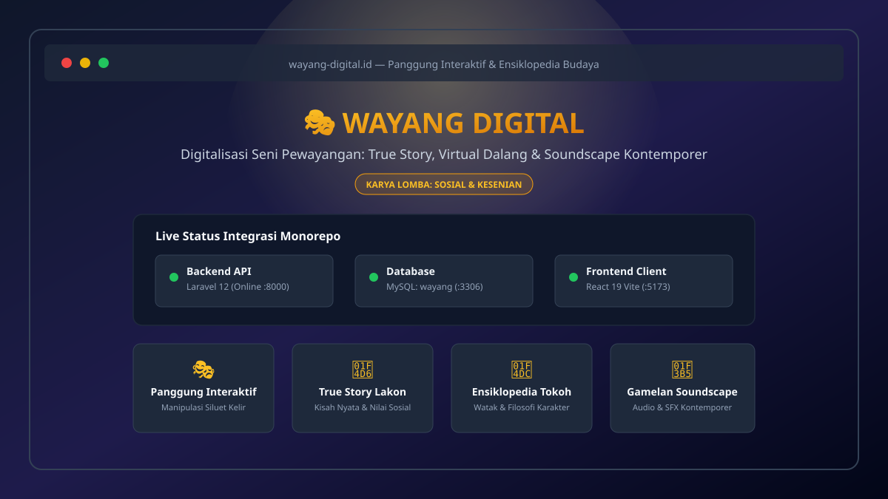

# 🎭 WAYANGVERSE (Wayang Digital) — Platform Pelestarian & Pagelaran Seni Wayang Digital Interaktif

> 🏆 **KARYA INOVASI TEKNOLOGI & KEBUDAYAAN**  
> **Tema Utama:** Sosial dan Kesenian | **Sub-Tema:** Revitalisasi Budaya Tradisional Berbasis Digital, Gamifikasi Interaktif, dan *Living Kelir Mystique*  
> **Platform:** Web Responsive Monorepo (React 19 + Laravel 12 REST API + MySQL)

---

[](https://laravel.com)
[-61DAFB?style=for-the-badge&logo=react&logoColor=black)](https://react.dev)
[](https://developers.google.com/mediapipe)
[](https://developer.mozilla.org/en-US/docs/Web/API/Web_Audio_API)
[](https://mysql.com)
[](LICENSE)

---

## 📌 Ringkasan Deskripsi GitHub (Copy-Paste Ready)

Jika Anda ingin mengisi kolom **About / Description** dan **Topics** pada repositori GitHub:

### Deskripsi Singkat (Repository Description):
```text
🎭 Platform interaktif digitalisasi & pagelaran seni wayang kulit Nusantara: Virtual Kelir 16:9, Story Atlas, AI Dalang Vision (MediaPipe Gesture Tracking), Web Audio Gamelan Synthesis, dan Connected Archive.
```

### GitHub Topics / Tags:
```text
wayang, wayang-kulit, indonesian-culture, digital-heritage, react19, vite, laravel12, mediapipe, web-audio-api, gamification, interactive-theater, monorepo, cultural-preservation
```

---

## 📸 Preview Platform


---

## 📜 Daftar Isi
1. [Latar Belakang & Nilai Inovasi](#-latar-belakang--nilai-inovasi)
2. [Fitur-Fitur Unggulan](#-fitur-fitur-unggulan)
3. [Arsitektur Sistem & Tech Stack](#-arsitektur-sistem--tech-stack)
4. [Struktur Direktori Monorepo](#-struktur-direktori-monorepo)
5. [Prasyarat Sistem (Prerequisites)](#-prasyarat-sistem-prerequisites)
6. [Panduan Instalasi & Menjalankan Proyek](#-panduan-instalasi--menjalankan-proyek)
7. [Panduan Penggunaan Lengkap (User Guide)](#-panduan-penggunaan-lengkap-user-guide)
8. [Akun Demo & Uji Coba (Kredensial Evaluator / Juri)](#-akun-demo--uji-coba-kredensial-evaluator--juri)
9. [Ringkasan RESTful API Endpoints](#-ringkasan-restful-api-endpoints)
10. [Panduan Pemecahan Masalah (Troubleshooting)](#-panduan-pemecahan-masalah-troubleshooting)
11. [Integritas Budaya & Desain Anti-AI Slop](#-integritas-budaya--desain-anti-ai-slop)
12. [Lisensi & Hak Cipta](#-lisensi--hak-cipta)

---

## 🌟 Latar Belakang & Nilai Inovasi

### 1. Tantangan Sosial Budaya
Wayang kulit merupakan mahakarya warisan kemanusiaan takbenda (*Masterpiece of the Oral and Intangible Heritage of Humanity* oleh UNESCO). Namun kesenian adiluhung ini menghadapi jurang apresiasi yang nyata di kalangan generasi muda (*Gen Z & Alpha*):
* **Durasi Pentas yang Terlalu Panjang:** Pertunjukan konvensional berlangsung semalam suntuk (7–8 jam non-stop).
* **Hambatan Bahasa & Konteks:** Penggunaan bahasa kawi/jawa kuno yang elitis dan minim penjelasan konteks moral.
* **Komunikasi Pasif Satu Arah:** Penonton hanya duduk pasif tanpa memiliki sarana bereksperimen langsung dengan penokohan, lakon, dan estetika pedalangan.
* **Informasi Terfragmentasi:** Cerita, karakter, filosofi watak, dan tata suara sering terserak tanpa relasi data yang utuh.

### 2. Solusi & Terobosan Wayangverse
**Wayangverse** mengubah cara pandang generasi muda terhadap kesenian wayang: **dari sekadar menonton menjadi mengalami, berkreasi, dan menjaga keberlanjutan tradisi.**
* **Virtual Kelir Stage (Kanvas 16:9):** Panggung manipulasi siluet tokoh berbasis vektor SVG presisi dengan sistem koordinat normalisasi `(0.0 – 1.0)`.
* **AI Dalang Vision (MediaPipe Gesture Tracking):** Memanfaatkan webcam untuk membaca gestur tangan dalang secara realtime dan menggerakkan tokoh wayang di layar secara alami.
* **Fail-Soft Web Audio Synthesis:** Menghadirkan atmosfer gamelan pentatonis (*Slendro & Pelog*), ketukan kotak dalang (*dodogan*), kepyak logam, dan gong ageng tanpa ketergantungan file audio eksternal berat (zero 404 assets).
* **Connected Archive & Cultural Provenance:** Setiap karya lakon yang diciptakan terhubung ke naskah babon rujukan (*Kakawin Bharatayuddha, Serat Dewa Ruci, Ramayana*), menjamin pemisahan yang sehat antara pakem tradisi dan interpretasi kreatif modern.
* **Dual-Layer Persistence:** Dukungan penuh untuk mode *offline-first* dengan sinkronisasi cerdas antara `localStorage/IndexedDB` dan database cloud backend via Laravel Sanctum.

---

## 🚀 Fitur-Fitur Unggulan

| Modul | Nama Fitur | Deskripsi Fungsional |
| :--- | :--- | :--- |
| **🎭 Studio Panggung** | **Virtual Kelir Canvas (16:9)** | Kanvas tata panggung wayang dengan pencahayaan lampu minyak *Blencong* dinamis, drag & drop bebas, translasi sumbu X/Y, rotasi sudut sendi wayang, layer z-index, serta penyesuaian skala. |
| **🎭 Studio Panggung** | **Multi-Pose & Solah Gerak** | Variasi pose otentik per karakter (Pose Default, Sembah/Hormat, Laga/Perang, Memanah Pasopati, Terbang Angkasa) serta fitur flip hadap kiri/kanan. |
| **👁️ Dalang Vision** | **AI Gesture Motion Tracking** | Deteksi gestur tangan dan jari via webcam berbasis `@mediapipe/tasks-vision` (PiP window), memungkinkan peragaan wayang tanpa menyentuh mouse/keyboard. |
| **🥽 Imersif AR** | **Wayang AR Stage Modal** | Pratinjau pertunjukan dengan overlay Augmented Reality langsung pada lingkungan fisik pengguna. |
| **🎬 Timeline Adegan** | **Scene Composer & Filmstrip** | Sutradarai babak cerita lakon: tambah, duplikasi, atur urutan adegan (*reorder*), durasi transisi (ms), balon kata tutur dialog, serta penggantian latar kelir (Blencong Klasik, Senja Kurusetra, Pringgandani Mistis, Alun-Alun Keraton). |
| **🎵 Tata Suara** | **Procedural Gamelan Synthesis** | Synthesizer berbasis Web Audio API browser: ketukan *dodogan* kayu cempala, *kepyak* tembaga, getaran harmonik *gong ageng*, serta gending dinamis tanpa risiko error aset audio 404. |
| **📖 Ensiklopedia** | **Story & Character Atlas** | Katalog digital lengkap tokoh pewayangan (Raden Gatotkaca, Arjuna, Karna, Werkudara, Semar, Rahwana, dll.) mencakup filosofi hidup, senjata pusaka, silsilah, ragam tradisi/gagrag (Surakarta, Yogyakarta, Pesisiran, Banyumasan), dan tombol instan **"Bawa ke Panggung"**. |
| **🏛️ Galeri Publik** | **Connected Archive** | Arsip pagelaran karya komunitas dalang digital dengan mode putar teater layar penuh, auto-advance scene sesuai durasi naskah, tombol apresiasi (confetti), dan pelacakan naskah pakem asal. |
| **🎨 Sanggar Pengguna** | **Karya Saya (My Works Studio)** | Dasbor pribadi dalang untuk menyimpan draf pementasan, mengedit ulang lakon, menggandakan karya, ekspor/impor cadangan format JSON, dan pengaturan status visibilitas (Privat / Publik). |
| **🛡️ Panel Kurasi** | **CMS Administrator & Moderasi** | Panel manajemen data terproteksi role admin: CRUD Master Tokoh Wayang, Master Cerita Lakon, Master Audio, moderasi karya publik, serta metrik analitik aktivitas sistem. |

---

## 🏛️ Arsitektur Sistem & Tech Stack

```text
┌─────────────────────────────────────────────────────────────────────────────┐
│                            KLIEN WEB (BROWSER)                              │
│                                                                             │
│  [ React 19 SPA ] ─── [ Zustand Store ] ─── [ MediaPipe AI Vision ]        │
│          │                     │                       │                    │
│          ▼                     ▼                       ▼                    │
│  [ Virtual Kelir 16:9 ]  [ Scene Composer ]  [ Web Audio Synthesizer ]      │
└──────────────────────────────────────┬──────────────────────────────────────┘
                                       │
                      HTTP REST API / Axios (CORS Protected)
                      Dual-Layer Persistence (API + Local Fallback)
                                       ▼
┌─────────────────────────────────────────────────────────────────────────────┐
│                       BACKEND API (LARAVEL 12 ENGINE)                       │
│                                                                             │
│  • Routes: /api/stories, /api/characters, /api/performances, /api/admin     │
│  • Security: Laravel Sanctum, CSRF Cookie, Rate Limiting (Throttle)         │
│  • Middleware: Role-Based Access Control (Admin / User / Guest)             │
│  • Controllers: Clean REST Architecture with JSON API Envelope              │
└──────────────────────────────────────┬──────────────────────────────────────┘
                                       │
                             PDO Database Connection
                                       ▼
┌─────────────────────────────────────────────────────────────────────────────┐
│                      DATABASE MYSQL ('wayang' Port 3306)                     │
│                                                                             │
│  • users (Dalang accounts, Sanctum tokens)                                  │
│  • characters (Master wayang, SVG siluet, pose, senjata, filosofi)         │
│  • stories & sources (Babon lakon, pupuh kakawin, gagrag tradisi)          │
│  • performances (scene_data JSON, koordinat normalisasi, dialog, audio)    │
│  • audio_assets, sessions, cache, jobs                                      │
└─────────────────────────────────────────────────────────────────────────────┘
```

### Rincian Teknologi:
* **Frontend**: React 19, Vite 8, Zustand (State Management), `@mediapipe/tasks-vision` (AI Hand Tracking), Web Audio API, Lucide Icons, Canvas Confetti, CSS Custom Properties (*Heritage Design System*).
* **Backend**: Laravel 12 (PHP 8.2+), Laravel Sanctum (SPA Authentication), Eloquent ORM, CORS Security Middleware.
* **Database**: MySQL 8.0+ (InnoDB, UTF8mb4).
* **Arsitektur Repositori**: Monorepo terpadu terisolasi (`fe/` dan `be/`) dengan skrip kendali root.

---

## 📁 Struktur Direktori Monorepo

```text
wayang/
├── be/                                # Backend API (Laravel 12 Engine)
│   ├── app/Http/Controllers/Api/      # Endpoint Controllers (Auth, Character, Story, Performance, Admin)
│   ├── app/Models/                    # Eloquent Models (User, Character, Story, Performance, Source, AudioAsset)
│   ├── config/cors.php                # Proteksi CORS khusus port frontend
│   ├── database/migrations/           # Skema tabel database lengkap berindeks
│   ├── database/seeders/              # Seeder akun resmi juri & Master Data kultural
│   ├── routes/api.php                 # Rute RESTful API publik & terproteksi Sanctum
│   ├── storage/app/public/            # Direktori penyimpanan media & upload
│   ├── .env.example                   # Template konfigurasi environment backend
│   └── composer.json
│
├── fe/                                # Frontend UI (React 19 + Vite)
│   ├── public/audio/                  # Sampel suara dan suluk
│   ├── public/images/                 # Aset latar kelir dan ornamen kultural
│   ├── src/
│   │   ├── components/
│   │   │   ├── layout/                # Navbar, Footer, Dynamic Modals
│   │   │   ├── stage/                 # WayangFigureSvg.jsx (6 figur SVG otentik & pose)
│   │   │   └── ui/                    # WayangLoadingScreen, AnimatedCounter, Alert
│   │   ├── features/
│   │   │   ├── admin/                 # AdminCmsView.jsx (Panel moderasi & master data)
│   │   │   ├── auth/                  # AuthModal.jsx (Login/Register Sanctum)
│   │   │   ├── encyclopedia/          # AtlasView.jsx (Ensiklopedia tokoh & cerita)
│   │   │   ├── home/                  # HomeView.jsx (Landing page imersif)
│   │   │   ├── stage/                 # VirtualStageCanvas, SceneComposer, DalangVisionPip, WayangArStageModal
│   │   │   └── story/                 # ConnectedArchiveView.jsx (Galeri pagelaran publik)
│   │   ├── services/
│   │   │   ├── api.js                 # Axios API Service bridge
│   │   │   ├── soundscape.js          # Web Audio API Synthesizer (Dodogan, Kepyak, Gong)
│   │   │   └── persistenceService.js  # Dual-layer storage (API + Local fallback)
│   │   ├── App.jsx                    # Routing tab & state global aplikasi
│   │   ├── App.css                    # Master styling Living Kelir Mystique
│   │   └── main.jsx
│   ├── .env.example                   # Template environment variabel frontend
│   └── package.json
│
├── docs/                              # Dokumentasi Resmi & Spesifikasi Produk
│   ├── screenshots/                   # Banner visual preview
│   ├── PRD.md                         # Product Requirements Document
│   ├── DESIGN-CONCEPT.md              # Panduan estetika Living Kelir & Anti-AI Slop
│   ├── LAPORAN_DAN_PANDUAN_BACKEND.md # Panduan komprehensif arsitektur API
│   └── MASTER_DATA_BACKEND_GUIDE.md   # Sanad naskah kakawin & data pakem wayang
│
├── .gitignore                         # Standar zero-trust gitignore
├── AGENTS.md                          # Direktif orkestrasi arsitektur tim & AI agent
├── LICENSE                            # Lisensi resmi terbuka (MIT)
├── package.json                       # Root script monorepo
└── README.md                          # Dokumentasi utama proyek
```

---

## ⚙️ Prasyarat Sistem (Prerequisites)

Sebelum memasang dan menjalankan proyek, pastikan lingkungan komputer Anda telah terpasang perangkat lunak berikut:

* **PHP**: Versi `>= 8.2` (Direkomendasikan PHP 8.2 atau 8.3 via XAMPP)
* **Composer**: Versi `>= 2.2` (Manajer paket dependensi PHP)
* **Node.js**: Versi LTS `>= 20.x` dan `npm`
* **MySQL Server**: Port `3306` (Dapat dijalankan langsung melalui XAMPP Control Panel)
* **Webcam (Opsional)**: Untuk memanfaatkan fitur pelacakan gestur tangan **Dalang Vision (MediaPipe)**

---

## 🚀 Panduan Instalasi & Menjalankan Proyek

Ikuti langkah-langkah di bawah ini secara berurutan untuk memasang dan menjalankan proyek pada perangkat lokal Anda:

### Langkah 1: Persiapan Database MySQL
1. Buka aplikasi **XAMPP Control Panel**.
2. Klik tombol **Start** pada modul **Apache** dan **MySQL**.
3. Buka browser dan kunjungi `http://localhost/phpmyadmin`.
4. Buat database baru bernama: **`wayang`** dengan *Collation*: `utf8mb4_unicode_ci`.

---

### Langkah 2: Setup & Jalankan Backend Laravel (`be/`)
Buka terminal (PowerShell atau Command Prompt), lalu jalankan perintah berikut:

```powershell
# 1. Masuk ke direktori backend
cd be

# 2. Unduh dan pasang dependensi backend
composer install

# 3. Buat file .env dari template
copy .env.example .env

# 4. Buat kunci enkripsi aplikasi Laravel
php artisan key:generate

# 5. Jalankan migrasi database dan isi data master (WAJIB!)
php artisan migrate --seed

# 6. Hubungkan direktori storage publik (untuk aset media)
php artisan storage:link

# 7. Jalankan server lokal Laravel
php artisan serve
```

> 💡 **Informasi Server Backend:**  
> Server backend akan berjalan pada: **`http://127.0.0.1:8000`**  
> Uji koneksi status API di browser: **`http://127.0.0.1:8000/api/status`** (Harus mengembalikan JSON `status: success` dan `database.connected: true`).

---

### Langkah 3: Setup & Jalankan Frontend React (`fe/`)
Buka **jendela terminal baru**, lalu jalankan perintah:

```powershell
# 1. Masuk ke direktori frontend
cd fe

# 2. Unduh dependensi frontend (React 19, MediaPipe, Zustand, dll.)
npm install

# 3. Buat file .env dari template
copy .env.example .env

# 4. Jalankan server development Vite
npm run dev
```

> 🌐 **Akses Aplikasi:**  
> Buka browser pada alamat: **`http://localhost:5173`**  
> Kartu **Status Integrasi API & Database** pada aplikasi akan secara otomatis mendeteksi koneksi aktif ke Laravel 12 dan database MySQL `wayang`.

---

### Alternatif: Menjalankan Perintah dari Root Workspace
Repositori ini telah dilengkapi dengan helper script pada file `package.json` di root direktori:

```bash
# Menjalankan frontend dev server dari root:
npm run dev

# Memeriksa kualitas kode & linting (0 error standard):
npm run lint

# Menghasilkan production build frontend:
npm run build
```

---

## 📖 Panduan Penggunaan Lengkap (User Guide)

### 1. Menavigasi Beranda (Home View)
* Saat membuka aplikasi, Anda akan disambut oleh animasi kultural *Gunungan & Cakra Surya Majapahit*.
* Di halaman utama, periksa kartu **Status Integrasi API & Database**. Jika indikator berwarna hijau, Frontend dan Backend berkomunikasi dengan sempurna.
* Klik tombol **"Masuk ke Studio Panggung"** untuk mulai menyutradarai lakon, atau klik **"Jelajahi Story Atlas"** untuk membaca ensiklopedia tokoh.

### 2. Mengoperasikan Studio Panggung Virtual (Virtual Stage Studio)
1. **Menambah Tokoh Wayang ke Panggung:**
   * Klik tombol **"+ Tambah Karakter"** di panel atas kanvas.
   * Pilih tokoh yang diinginkan (contoh: *Raden Gatotkaca, Arjuna, Bima, Karna, Semar, Rahwana*).
   * Tokoh akan muncul seketika di atas kelir dengan rasio proporsional.
2. **Mengendalikan Posisi & Solah Tokoh:**
   * **Mouse / Layar Sentuh:** Klik dan geser (*drag-and-drop*) wayang ke koordinat panggung yang diinginkan.
   * **Keyboard Accessibility:** Klik wayang, lalu gunakan tombol panah `ArrowLeft`, `ArrowRight`, `ArrowUp`, dan `ArrowDown` pada keyboard Anda.
   * **D-Pad Virtual:** Gunakan tombol arah D-Pad visual yang tersedia di toolbar panggung.
3. **Mengatur Pose, Arah Hadap, & Skala:**
   * Klik salah satu karakter pada daftar *Active Puppets*.
   * Pilih variasi pose (cth: *Sembah*, *Laga/Perang*, *Memanah*, atau *Terbang*).
   * Klik tombol **"Balik Arah (Flip)"** untuk membalik arah hadap tokoh (kiri ⇄ kanan).
   * Sesuaikan ukuran tokoh menggunakan *slider* skala jika ingin menampilkan adegan perspektif jauh/dekat.
4. **Mengganti Latar Kelir (Backdrop):**
   * Klik menu **"Ganti Latar Kelir"** untuk memilih suasana:
     * *Kelir Klasik (Pendar Minyak Blencong)*
     * *Senja Kurusetra (Atmosfer Perang Bharatayuddha)*
     * *Pringgandani Mistis (Kraton Ksatria Udara)*
     * *Alun-Alun Keraton (Suasana Paseban Agung)*

### 3. Menggunakan AI Dalang Vision (Camera Gesture Tracking)
1. Di dalam Studio Panggung, klik tombol **"👁️ Dalang Vision"**.
2. Berikan izin akses kamera (*webcam*) pada browser Anda.
3. Jendela *Picture-in-Picture* (PiP) akan menampilkan pelacakan kerangka jari dan tangan Anda melalui model **Google MediaPipe Vision**.
4. Gerakkan telapak tangan ke kiri, kanan, atas, atau bawah di depan kamera; wayang yang sedang aktif di panggung akan mengikuti gerak tangan Anda secara luwes layaknya seorang dalang memainkan cempurit wayang fisik!

### 4. Menggubah Babak Cerita (Scene Composer & Dialog)
1. Perhatikan panel **Scene Composer / Filmstrip** di bagian bawah studio.
2. Klik **"+ Tambah Adegan"** untuk menyusun babak berikutnya dari lakon Anda.
3. Masukkan narasi atau teks tutur kata pada kolom **Dialog Balon**. Dialog akan muncul sebagai balon kata elegan khas pewayangan di atas tokoh saat adegan diputar.
4. Atur durasi tiap babak (misal: 4000 ms = 4 detik) untuk menentukan tempo pergantian adegan otomatis.

### 5. Memainkan Tata Suara & Gamelan (Web Audio Soundscape)
* Di sudut kanan atas panggung, Anda dapat membunyikan instrumen gamelan kapan saja:
  * Tombol **"Dodogan"**: Membunyikan ketukan kotak kayu dalang (*tok-tok*).
  * Tombol **"Kepyak"**: Menghasilkan suara derak lempengan logam perunggu (*pyak-pyak*).
  * Tombol **"Gong"**: Memicu dentuman resonansi harmonik gong ageng (*gwoong*).
  * Tombol **"Play Gamelan"**: Memutar iringan tangga nada Slendro/Pelog yang disintesis secara prosedural.

### 6. Pratinjau & Menyimpan Karya (Save & Preview)
1. Klik tombol **"▶ Preview Pentas"** untuk menyaksikan pertunjukan dalam mode teater layar penuh. Sistem akan menjalankan auto-advance adegan sesuai durasi yang telah disusun.
2. Klik tombol **"💾 Simpan Karya"**:
   * Masukkan **Judul Pagelaran** dan **Sinopsis Singkat**.
   * Pilih **Lakon Cerita Rujukan** (untuk menautkan karya ke sanad naskah babon budaya).
   * Tentukan status visibilitas:
     * **Publik**: Karya akan dipamerkan di galeri publik *Connected Archive* dan dapat ditonton oleh siapa saja.
     * **Privat**: Karya hanya tersimpan di ruang kerja *Karya Saya* Anda.
3. Klik **"Simpan ke Sanggar"**. Proyek akan tersimpan ke database backend Laravel (atau ke penyimpanan lokal jika Anda sedang dalam mode offline).

### 7. Menonton di Connected Archive (Galeri Publik)
* Buka tab **"Arsip Galeri"** pada menu navigasi.
* Telusuri karya-karya pementasan yang telah dipublikasikan oleh para dalang digital lainnya.
* Gunakan filter cerita untuk menyaring karya berdasarkan lakon spesifik (*Gugurnya Gatotkaca, Karno Tanding, dll.*).
* Klik karya untuk memutar ulang pementasan secara utuh, membaca naskah rujukan, serta memberikan tombol apresiasi (*applause confetti*).

### 8. Menjelajahi Story & Character Atlas (Ensiklopedia)
* Buka tab **"Story Atlas"** pada menu navigasi.
* Pilih tab **"Karakter Wayang"** untuk mempelajari watak, senjata, silsilah keturunan, dan nilai filosofis luhur setiap tokoh.
* Klik tombol **"🎭 Bawa ke Panggung"** pada kartu karakter untuk langsung membawa tokoh tersebut ke adegan aktif di Studio Panggung tanpa perlu mencari ulang!
* Pilih tab **"Lakon Cerita"** untuk membaca ringkasan wiracarita, pembagian babak, dan sanad naskah rujukan kuno (*Mpu Sedah, Mpu Panuluh, Balai Pustaka*).

### 9. Panel Kurasi & CMS Administrator (Admin View)
* Masuk menggunakan akun ber-role Admin (lihat kredensial di bawah).
* Buka tab **"Admin CMS"** di navigasi:
  * **Moderasi Pagelaran:** Mengubah status visibilitas karya publik (*public / draft / unlisted*) atau menghapus karya yang melanggar ketentuan.
  * **Master Karakter:** Menambah, menyunting, dan memperbarui data watak, SVG siluet, pusaka, serta pose wayang.
  * **Master Cerita:** Mengelola katalog naskah lakon dan atribusi sumber pustaka.
  * **Statistik Sistem:** Memantau metrik total dalang aktif, karya tersimpan, dan kesehatan basis data.

---

## 👤 Akun Demo & Uji Coba (Kredensial Evaluator / Juri)

Sistem telah dilengkapi dengan akun demonstrasi siap pakai yang otomatis digenerate saat menjalankan perintah `php artisan migrate --seed`:

| Tipe Akun | Email Login | Password | Peran & Hak Akses |
| :--- | :--- | :--- | :--- |
| **Juri / Evaluator Lomba** | `demo@wayangdigital.id` | `Wayang@2026!` | **Admin** (Akses penuh: Studio, Atlas, Galeri, dan Panel CMS Moderasi) |
| **Dalang Muda (Kreator)** | `dalang_demo@wayangverse.id` | `dalang2026!` | **User** (Akses: Studio Panggung, Simpan Karya Saya, dan Publikasi Galeri) |
| **Administrator Sistem** | `admin@wayangdigital.id` | `Admin@2026!` | **Admin** (Akses penuh manajemen master data dan operasional) |

> 🔑 **Cara Login:** Klik ikon profil / tombol **"Masuk / Sanggar"** di bilah navigasi kanan atas, lalu masukkan email dan password di atas.

---

## 🔌 Ringkasan RESTful API Endpoints

Seluruh respon REST API menggunakan amplop JSON standar (*standardized JSON envelope*):
```json
{
  "status": "success",
  "message": "Data berhasil dimuat",
  "data": { ... }
}
```

### 1. Endpoint Publik & Kesehatan Sistem
* `GET  /api/status` — Memeriksa konektivitas backend Laravel dan status koneksi MySQL `wayang`.
* `POST /api/login` — Autentikasi pengguna (dibatasi rate limiter `throttle:10,1`).
* `POST /api/register` — Pendaftaran akun dalang baru.

### 2. Master Data Katalog Terbuka
* `GET  /api/stories` — Mengambil daftar lakon cerita terkurasi beserta relasi tokoh & sumber rujukan.
* `GET  /api/stories/{slug}` — Mengambil detail lakon berdasarkan slug naskah.
* `GET  /api/characters` — Mengambil seluruh katalog karakter wayang, pose, dan filosofi.
* `GET  /api/characters/{slug}` — Mengambil detail figur wayang berdasarkan slug.
* `GET  /api/audio-assets` — Mengambil daftar aset tata suara dan suluk budaya.

### 3. Arsip Galeri Publik
* `GET  /api/public/performances` — Mengambil daftar pementasan yang dipublikasikan oleh para dalang.
* `GET  /api/public/performances/{id}` — Mengambil data adegan (`scene_data`) untuk pemutaran ulang di teater.

### 4. Manajemen Karya Pengguna (Wajib Token Sanctum)
* `GET    /api/user` — Memeriksa profil pengguna yang sedang login.
* `POST   /api/logout` — Mencabut sesi token pengguna.
* `GET    /api/performances` — Mengambil seluruh karya milik pengguna aktif (*Karya Saya*).
* `POST   /api/performances` — Menyimpan proyek pementasan baru (validasi skema JSON `scene_data`).
* `GET    /api/performances/{id}` — Membuka kembali susunan babak karya yang pernah disimpan.
* `PATCH  /api/performances/{id}` — Memperbarui data pementasan, koordinat tokoh, atau dialog.
* `DELETE /api/performances/{id}` — Menghapus karya milik pengguna.

### 5. Panel CMS Administrator (`/api/admin/*`, Wajib Role Admin)
* `GET    /api/admin/stats` — Mengambil metrik total pengguna, total karya, dan statistik konten.
* `GET    /api/admin/performances` — Daftar seluruh pementasan lintas pengguna untuk kebutuhan moderasi.
* `PATCH  /api/admin/performances/{id}/visibility` — Mengubah status visibilitas karya (*public / draft / unlisted*).
* `POST   /api/admin/characters` — Menambah tokoh wayang baru ke master data.
* `PATCH  /api/admin/characters/{id}` — Menyunting data master karakter wayang.
* `DELETE /api/admin/characters/{id}` — Menghapus tokoh wayang dari master data.
* `POST   /api/admin/stories` — Menambah lakon cerita baru beserta atribusi pustaka.

---

## 🛠️ Panduan Pemecahan Masalah (Troubleshooting)

| Masalah / Gejala | Kemungkinan Penyebab | Langkah Solusi |
| :--- | :--- | :--- |
| **Status API / Database "Offline"** | Server Laravel atau Apache/MySQL di XAMPP belum aktif. | 1. Pastikan modul MySQL & Apache di XAMPP dalam status **Start** (hijau).<br>2. Jalankan `cd be && php artisan serve` di terminal.<br>3. Klik tombol **"🔄 Cek Ulang Koneksi"** di web. |
| **Error: Table 'wayang.sessions' doesn't exist** | Migrasi tabel database belum dieksekusi. | Buka terminal dan jalankan: `cd be && php artisan migrate --seed`. Sistem memerlukan tabel ini karena menggunakan session berbasis database. |
| **Error: No application encryption key has been specified** | File `.env` belum memiliki `APP_KEY`. | Jalankan perintah `cd be && php artisan key:generate` di terminal backend. |
| **CORS Blocked di Console Browser** | Port frontend tidak cocok dengan pengaturan CORS backend. | Pastikan `FRONTEND_URL=http://localhost:5173` di file `be/.env`. Jika Anda menggunakan port lain (cth: `5174`), tambahkan port tersebut ke baris `CORS_ALLOWED_ORIGINS` di `be/.env`. |
| **Port 8000 Bentrok (Address already in use)** | Port 8000 sedang digunakan oleh aplikasi lain. | Jalankan backend di port alternatif: `php artisan serve --port=8080`, lalu ubah file `fe/.env` menjadi `VITE_API_URL=http://127.0.0.1:8080/api`. |
| **Dalang Vision: Kamera Tidak Muncul** | Izin webcam diblokir oleh browser atau perangkat tidak memiliki kamera. | 1. Klik ikon gembok di sebelah URL browser (`localhost:5173`), lalu ubah izin **Camera** menjadi **Allow**.<br>2. Muat ulang (*refresh*) halaman web. |

---

## 🎨 Integritas Budaya & Desain Anti-AI Slop

Proyek ini menjunjung tinggi standar kualitas visual dan kepatuhan pakem budaya (*Cultural Integrity*):
1. **Palet Warna Alami & Bernyawa (*Living Kelir Mystique*):**
   * Menggunakan perpaduan warna alami kayu soga (`#1a140e`), emas prada keraton (`#d4af37`), kain mori alami (`#faf6ee`), dan kedalaman malam kelir mistis (`#0c0a10`).
   * **Bebas dari AI-Slop:** Melarang efek glow neon murahan, border tebal sembarangan, bayangan kotor berlebihan, serta ikon dekoratif hampa makna.
2. **Sanad Naskah & Hak Cipta Pakem:**
   * Setiap wiracarita diverifikasi dengan naskah babon klasik (*Kakawin Bharatayuddha karya Mpu Sedah & Mpu Panuluh*, *Serat Rama*, dan *Pakem Pedalangan Gagrag Surakarta/Yogyakarta*).
   * Menegakkan pemisahan tegas antara karya berlabel **"Pakem Tradisi / Sumber Terkurasi"** dengan **"Interpretasi Kreatif Pengguna"**.

---

## 👥 Tim & Kontributor

* **Ketua Tim / Fullstack Architect:** Ahmad Fayyadh Fadhil
* **Kreatif & Kurasi Konten Budaya:** Tim Wayang Digital
* **Kategori Inovasi:** Lomba Inovasi Teknologi Nasional — Tema Sosial dan Kesenian (Digitalisasi & Revitalisasi Budaya Nusantara)

---

## 📄 Lisensi & Hak Cipta

Proyek ini didistribusikan secara terbuka di bawah lisensi resmi [MIT License](LICENSE).  
Hak Cipta © 2026 Ahmad Fayyadh Fadhil & Tim Wayang Digital.  
*Matur nuwun sanget kagem sedaya pihak ingkang sampun nyengkuyung pelestarian seni budaya pewayangan Nusantara.* 🇮🇩
